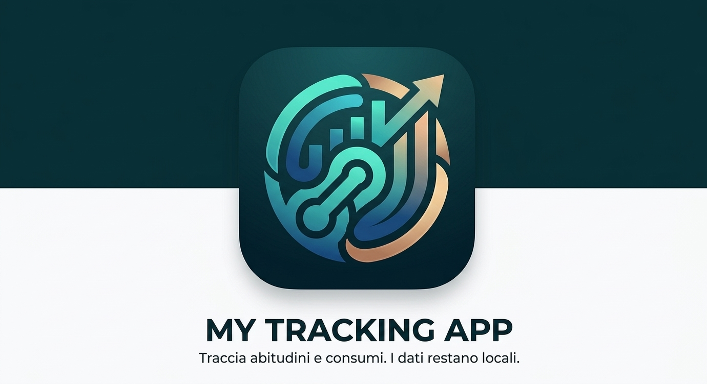
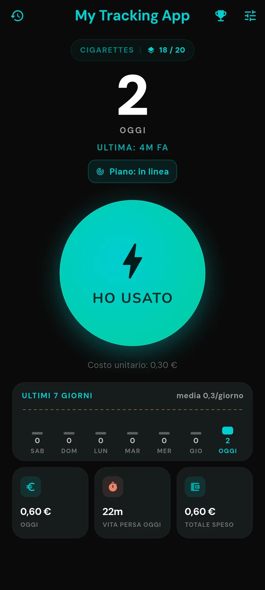
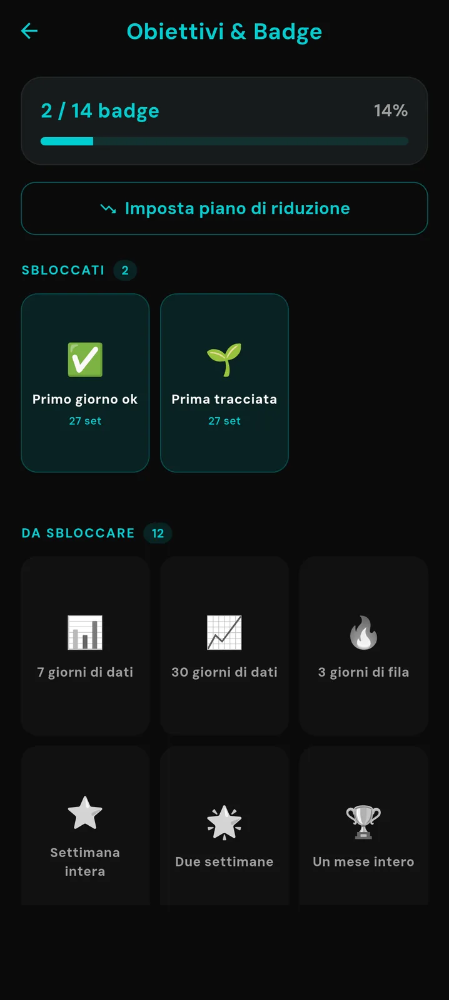
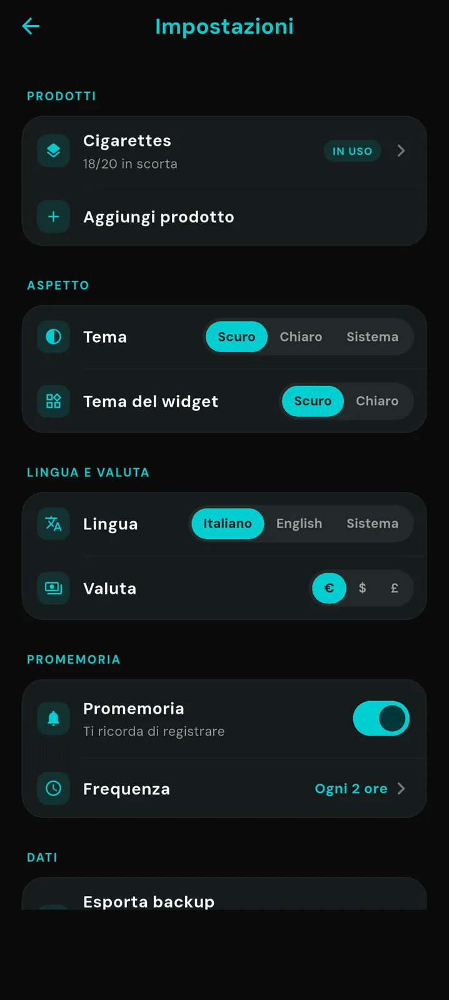
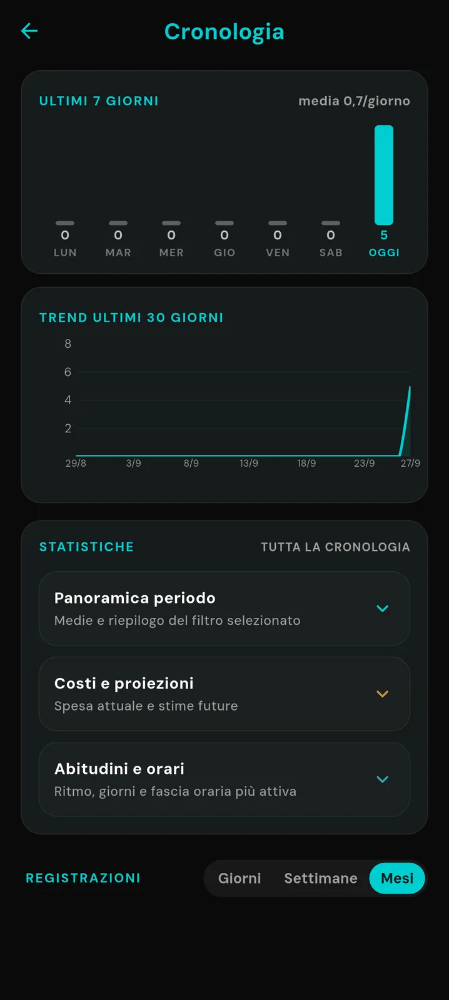
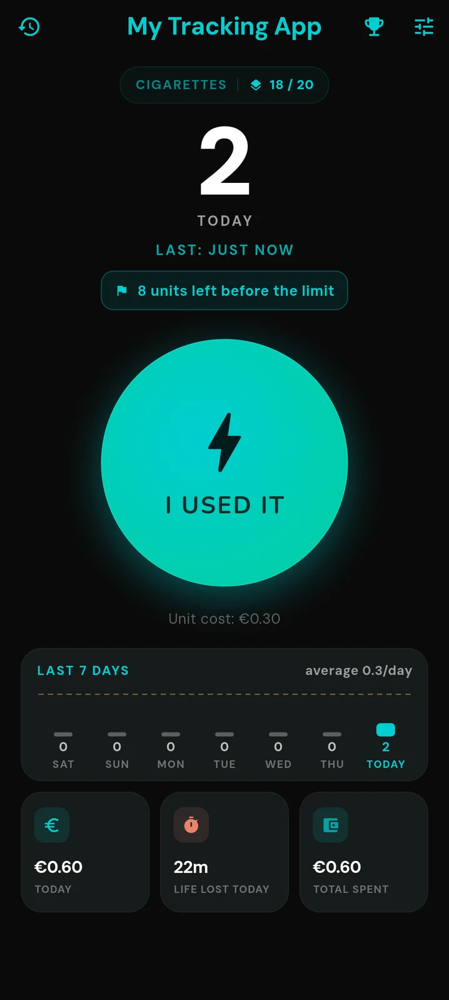
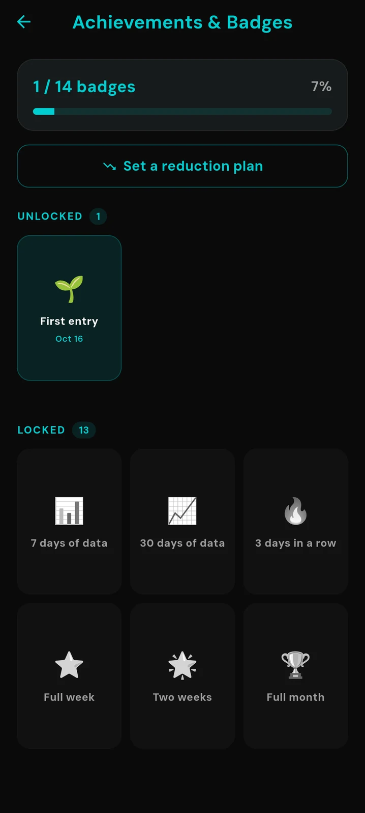
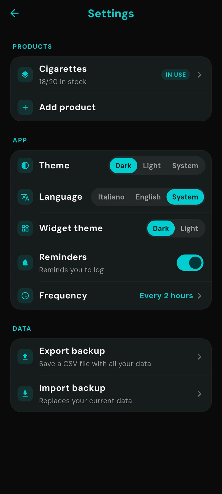
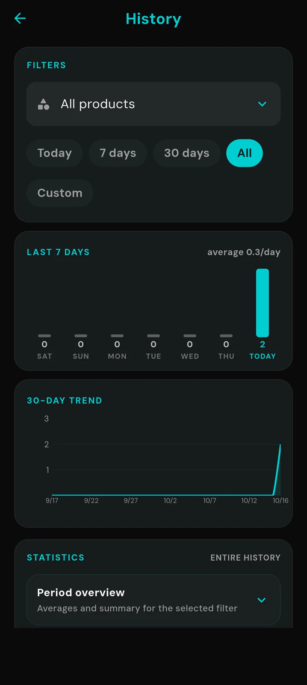

# 🚀 My Tracking App

[](https://github.com/lorenzocaputodev/my_tracking_app/actions/workflows/ci.yml) [](https://github.com/lorenzocaputodev/my_tracking_app/releases/latest) [](LICENSE) 

🇮🇹 [Italiano](#-italiano) · 🇬🇧 [English](#-english)

📲 **Download:** [ultima versione / latest release](https://github.com/lorenzocaputodev/my_tracking_app/releases/latest) (APK)

---

## 🇮🇹 Italiano

> **Conta le sigarette, riduci al tuo ritmo e scopri quanto risparmi.**

- 🚬 Tieni sotto controllo sigarette, IQOS e svapo, o qualsiasi abitudine vuoi ridurre
- 🔒 Senza account e senza pubblicità: i tuoi dati restano solo sul tuo telefono
- 🌍 In italiano e in inglese: parte nella lingua del telefono e si cambia dalle impostazioni

### 📲 Scarica l’app

Vuoi solo installarla? Scarica l’APK dall’**[ultima versione pubblicata](https://github.com/lorenzocaputodev/my_tracking_app/releases/latest)** e aprilo dal telefono: Android ti chiederà di consentire l’installazione di app scaricate dal browser.

> **Avevi una versione precedente alla 1.4.0?** Dalla 1.4.0 l’app ha un nuovo identificativo, quindi Android la installa come app nuova. Per portare i tuoi dati: nella vecchia app vai in Impostazioni → **Esporta backup**, installa la nuova, usa **Importa backup** e poi disinstalla la vecchia.

### 📸 Schermate

<p align="center">
  
  
  
  
</p>

<p align="center"><sub>Home · Obiettivi e badge · Impostazioni · Cronologia</sub></p>

### ✨ Funzionalità principali

- 📦 Più prodotti da seguire, con un selettore rapido per passare dall’uno all’altro
- 📊 Home con conteggio giornaliero, scorta, costi e ultimi 7 giorni
- 📈 Cronologia raggruppata per giorni, settimane e mesi, con grafici e statistiche
- ↩️ Annulla dopo ogni registrazione e ogni cancellazione
- 🏆 Obiettivi e badge sbloccabili
- 📉 Piano di riduzione **indipendente per ogni prodotto**
- ⚙️ Impostazioni con una pagina per ogni prodotto, anche quando non è in uso
- 🗄️ Archiviazione dei prodotti con storico conservato
- 📄 Backup ed esportazione in CSV, ripristinabili già dalla prima configurazione
- ♿ Etichette per TalkBack e layout che regge il testo ingrandito dal sistema
- 📲 Widget Android per la schermata Home in tre dimensioni: **piccola**, **media** e **grande**, con tema scuro o chiaro
- 🔔 Promemoria periodici ogni 30 minuti, 1, 2, 4, 8 o 12 ore, proposti già alla prima configurazione
- 🎨 Tema **scuro / chiaro / sistema**
- 🌍 Lingua **italiano / inglese / sistema**: al primo avvio segue il telefono (italiano se è in italiano, altrimenti inglese)
- 💶 Valuta **€ / $ / £** a scelta nelle impostazioni, anche nel widget
- 🆕 «Controlla aggiornamenti» mostra la versione installata e apre la pagina delle nuove versioni su GitHub

### 🔐 Privacy e dati

- Nessun account richiesto e nessun backend
- Nessun accesso a internet: «Controlla aggiornamenti» apre la pagina nel browser
- Dati salvati solo sul dispositivo; il backup CSV lo esporti tu, quando vuoi

### 🧰 Compilare il progetto

Versioni su cui la build è verificata:

- Flutter **3.47.5** stable (Dart 3.13.4)
- Android SDK con platform **android-36**, build-tools 36.0.0 e NDK 28.2.13676358
- **JDK 21**: Gradle 8.14.5 non supporta JDK 25, quindi va agganciato con
  `flutter config --jdk-dir "<percorso del JDK 21>"`
- Solo per la versione Windows (usata per debug e test): Visual Studio Build Tools con i componenti C++ e **C++ ATL**

```bash
git clone https://github.com/lorenzocaputodev/my_tracking_app.git
cd my_tracking_app
flutter pub get
flutter run
```

- La catena di build usa Gradle 8.14.5, AGP 8.13.2 e Kotlin 2.2.21, volutamente entro la linea 8.x di AGP.
- `android/gradle.properties` dimensiona il daemon Gradle a 2 GB di heap: su macchine con poca RAM valori più alti lo fanno terminare a metà build.
- Le versioni pubblicate sono firmate con una chiave personale che non è nel repository: senza `android/key.properties` la build di release si ferma con un errore. Per provare l’app usa `flutter build apk --debug`.
- I testi dell’app sono in `lib/l10n/app_it.arb` e `app_en.arb` (generati con `flutter gen-l10n`); quelli del widget in `android/app/src/main/res/values/` e `values-it/`.

### 📂 Struttura essenziale

- `lib/models/` → modelli dati
- `lib/providers/` → stato applicativo e persistenza
- `lib/screens/` → schermate principali
- `lib/widgets/` → componenti UI riutilizzabili
- `lib/l10n/` → traduzioni italiano e inglese
- `lib/theme/` → token di design, temi e decorazioni
- `lib/utils/` → utility, bridge e formattazione
- `android/app/src/main/kotlin/dev/lorenzocaputo/mytrackingapp/widget/` → widget Android nativo

### 👨‍💻 Sviluppo

Durante lo sviluppo, il debugging e la rifinitura del progetto è stato utilizzato supporto AI come assistenza tecnica per troubleshooting, revisione della documentazione, verifica di problemi tecnici e supporto alla scrittura e pulizia del codice.

### 👤 Autore

**Lorenzo Caputo** · GitHub: [lorenzocaputodev](https://github.com/lorenzocaputodev) · Portfolio: [lorenzocaputo.is-a.dev](https://lorenzocaputo.is-a.dev/)

---

## 🇬🇧 English

> **Count your cigarettes, cut down at your own pace and see how much you save.**

- 🚬 Keep track of cigarettes, IQOS and vapes, or any habit you want to reduce
- 🔒 No account and no ads: your data stays on your phone only
- 🌍 In English and Italian: it starts in your phone's language and can be changed in Settings

### 📲 Download the app

Just want to install it? Download the APK from the **[latest release](https://github.com/lorenzocaputodev/my_tracking_app/releases/latest)** and open it on your phone: Android will ask you to allow installing apps downloaded from the browser.

> **Had a version older than 1.4.0?** Since 1.4.0 the app has a new identifier, so Android installs it as a new app. To bring your data over: in the old app go to Settings → **Export backup**, install the new one, use **Import backup** and then uninstall the old app.

### 📸 Screenshots

<p align="center">
  
  
  
  
</p>

<p align="center"><sub>Home · Achievements and badges · Settings · History</sub></p>

### ✨ Main features

- 📦 Track several products, with a quick switcher to move between them
- 📊 Home screen with daily count, stock, costs and the last 7 days
- 📈 History grouped by day, week and month, with charts and statistics
- ↩️ Undo after every entry and every deletion
- 🏆 Unlockable achievements and badges
- 📉 A reduction plan **for each product**
- ⚙️ Settings with a page for each product, even when it isn't in use
- 🗄️ Archive products and keep their history
- 📄 CSV backup and export, which you can restore right from the first setup
- ♿ TalkBack labels and a layout that handles enlarged system text
- 📲 Android home screen widget in three sizes: **small**, **medium** and **large**, with a dark or light theme
- 🔔 Periodic reminders every 30 minutes or 1, 2, 4, 8 or 12 hours, offered right at first setup
- 🎨 **Dark / light / system** theme
- 🌍 **Italian / English / system** language: on first launch it follows your phone (Italian if the phone is in Italian, English otherwise)
- 💶 Pick your currency (**€ / $ / £**) in Settings; the widget uses it too
- 🆕 “Check for updates” shows the installed version and opens the releases page on GitHub

### 🔐 Privacy and data

- No account and no backend
- No internet access: “Check for updates” opens the page in your browser
- Data is stored only on the device; you export the CSV backup yourself, whenever you want

### 🧰 Building the project

Versions the build is verified on:

- Flutter **3.47.5** stable (Dart 3.13.4)
- Android SDK with platform **android-36**, build-tools 36.0.0 and NDK 28.2.13676358
- **JDK 21**: Gradle 8.14.5 doesn't support JDK 25, so set it with
  `flutter config --jdk-dir "<path to JDK 21>"`
- Windows build only (used for debugging and tests): Visual Studio Build Tools with the C++ and **C++ ATL** components

```bash
git clone https://github.com/lorenzocaputodev/my_tracking_app.git
cd my_tracking_app
flutter pub get
flutter run
```

- The build chain uses Gradle 8.14.5, AGP 8.13.2 and Kotlin 2.2.21, deliberately within the AGP 8.x line.
- `android/gradle.properties` gives the Gradle daemon a 2 GB heap: on machines with little RAM, higher values make it stop mid-build.
- Published releases are signed with a personal key that isn't in the repository: without `android/key.properties` the release build stops with an error. To try the app, use `flutter build apk --debug`.
- App strings live in `lib/l10n/app_it.arb` and `app_en.arb` (generated with `flutter gen-l10n`); widget strings in `android/app/src/main/res/values/` and `values-it/`.

The project structure is described in the Italian section above.

### 👨‍💻 Development

AI tools were used during development, debugging and polishing as technical support for troubleshooting, documentation review, checking technical issues and help with writing and cleaning up the code.

### 👤 Author

**Lorenzo Caputo** · GitHub: [lorenzocaputodev](https://github.com/lorenzocaputodev) · Portfolio: [lorenzocaputo.is-a.dev](https://lorenzocaputo.is-a.dev/en/)
